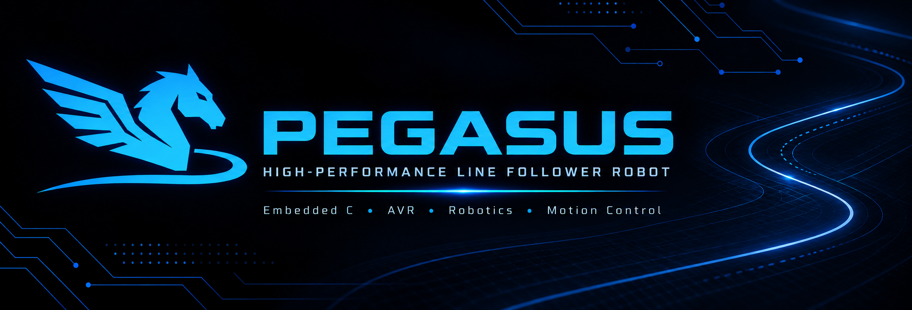

# PegasusCode

Firmware em C para o robô seguidor de linha Pegasus, com ATmega328P a 16 MHz, oito sensores analógicos e driver de motores TB6612FNG. Usa acesso direto aos registradores, sem framework Arduino.

A implementação atual faz calibração frontal e lateral, diagnóstico e até três ciclos de recalibração dos sensores reprovados. O controle de corrida ainda não está implementado; após calibrar, o robô permanece parado em `WAITING`.

## Operação

Ao ligar, os motores ficam parados. Pressione e solte o botão D2 antes de dois segundos para iniciar a calibração. Segurar por dois segundos leva a `WAITING`, sem calibrar. O botão é ativo alto, com pull-down externo.

O LED permanece aceso durante a calibração, apaga no sucesso e pisca em caso de falha. Para recalibrar após sucesso ou falha, solte o botão e faça um novo toque curto. O debounce exige 30 ms de estabilidade em cada borda.

Os limites dos sensores ficam somente na RAM. Desligar ou reiniciar exige nova calibração; não há salvamento ou restauração em EEPROM.

## Estrutura

| Caminho | Conteúdo |
| --- | --- |
| `src/main.c` | Inicialização de GPIO, ADC, PWM e Timer1 e máquina de estados principal |
| `src/calibration/calibration.c` | Coordenação dos estados da calibração e indicação de falha |
| `src/calibration/calibration_initial.c` | Preparação e aquisição frontal/lateral inicial |
| `src/calibration/calibration_diagnostic.c` | Diagnóstico, recalibração seletiva e conclusão |
| `src/calibration/calibration_filter.c` | Médias, filtro, extremos e aprovação dos sensores |
| `src/calibration/calibration_detection.c` | Detecção de branco/preto e leitura durante a recalibração |
| `src/diagnostics/motors.c` | Firmware separado para ensaio de motores e sensores |
| `include/` | Pinos, parâmetros e interfaces públicas |
| `lib/adc`, `lib/pwm`, `lib/timer` | Drivers utilizados pelo firmware |
| `tests/host/` | Testes de calibração com periféricos simulados |
| `docs/` | Hardware, calibração e desenvolvimento |

## Compilar e testar

```sh
pio run -e atmega328p
sh tests/host/run.sh
```

Também é possível compilar com AVR GCC: `make` e `make size`.

O ensaio separado compila com `pio run -e test_motors` e inicia movimento ao ligar, com PWM de 30%. Faça esse ensaio com as rodas suspensas.

## Documentação

- [Hardware e pinos](docs/hardware.md)
- [Sequência e filtro de calibração](docs/calibration.md)
- [Compilação, gravação e testes](docs/development.md)

O perfil PlatformIO usa `board = uno`. A montagem documentada utiliza Nano com ADC6/ADC7; o bootloader instalado determina a configuração correta de gravação.
