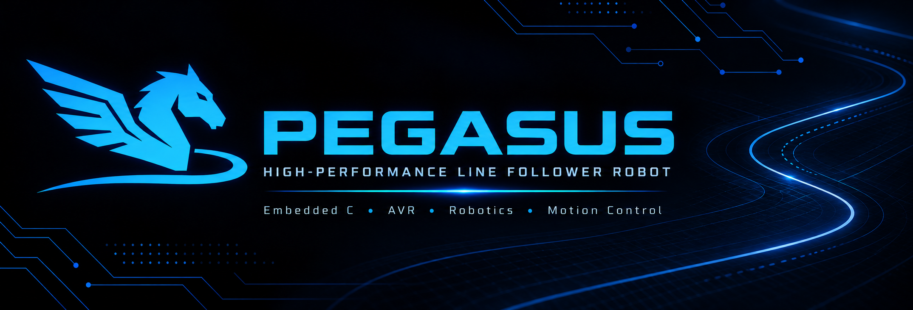

# PegasusCode



[](https://github.com/DiogoHantke/PegasusCode/actions/workflows/firmware-build.yml)


O PegasusCode é o firmware do Pegasus, um robô seguidor de linha desenvolvido em C para o ATmega328P. A proposta é aproveitar os periféricos do microcontrolador para ler a malha de sensores, interpretar a posição da linha e ajustar os dois motores por meio do TB6612FNG. O desenvolvimento acontece por etapas, começando pela calibração, que fornece a referência necessária para o controle da trajetória.

Neste repositório, o código e a documentação acompanham essa evolução. Os documentos explicam tanto o que já está funcionando no software quanto as próximas etapas, identificadas como planejamento, para que seja possível entender as decisões e continuar o desenvolvimento a partir delas.

## Como o firmware funciona hoje

Quando o ATmega328P inicia, o firmware configura os pinos, prepara o ADC e os temporizadores e aplica duty zero aos dois canais de PWM. Em seguida, entra na calibração e aguarda o botão para começar a leitura da malha frontal, formada pelos canais QTR01 a QTR06.

Com o botão acionado, os emissores são ligados e os motores recebem o comando definido para a calibração. Enquanto o robô percorre a superfície, cada sensor acumula suas próprias leituras. A cada dez amostras, o filtro calcula uma média e verifica se ela pode contribuir para os valores mínimo e máximo daquele canal. Assim, a aprovação acontece individualmente, conforme cada sensor apresenta o contraste necessário.

Quando os seis frontais são aprovados, o firmware zera o PWM e passa para o estado reservado à calibração lateral. Essa é a etapa em que a implementação se encontra: a rotina lateral ainda será desenvolvida, assim como o diagnóstico completo e o controle da corrida. Se a calibração frontal exceder o tempo permitido, o firmware interrompe os comandos de motor e entra em emergência.

O passo a passo, incluindo o filtro e as transições que existem no código, está em [Funcionamento do sistema: calibração](docs/system-operation.md).

## Como o projeto vai evoluir

A próxima etapa é calibrar os sensores laterais QTR00 e QTR07, respeitando a posição que eles ocupam na placa. Depois disso, o diagnóstico vai avaliar o conjunto e identificar quais sensores precisam repetir a calibração. Os canais aprovados deverão manter seus valores, enquanto os pendentes terão até três tentativas adicionais, sempre dentro dos limites de movimento e tempo definidos para o robô.

Com a calibração completa, a aplicação poderá aguardar a partida e iniciar o seguimento da linha. Nesse momento, as leituras serão normalizadas e combinadas para estimar a posição da faixa. O controlador PD usará a diferença entre essa posição e o centro da malha para ajustar o PWM dos motores. A velocidade também deverá acompanhar a qualidade da leitura: quando a referência ficar menos confiável, o robô reduzirá o comando e, se necessário, tentará recuperar a linha dentro de um limite definido.

Essas funções compõem a arquitetura prevista. As metas de período, latência e recuperação serão verificadas conforme cada etapa for implementada e ensaiada no hardware.

## Hardware do Pegasus

| Elemento | Referência de projeto |
| --- | --- |
| MCU | ATmega328P, 16 MHz, 32 KB Flash, 2 KB SRAM, 1 KB EEPROM |
| Malha de reflectância QTR | QTR01–QTR06 frontais e QTR00/QTR07 laterais em ADC0–ADC7; modelo comercial a confirmar |
| Emissores | D11/PB3 segundo código e esquema |
| Driver | TB6612FNG; PWM D5/OC0B e D6/OC0A |
| Direção | D4, D7, D8 e D9 conforme `src/main.c` |
| Botão / LED | D2 ativo alto no código; D13 indicador |
| Comunicação | USART0 em D0/D1; protocolo ainda não integrado ao controle |

Antes de acionar motores, confirmar em bancada qual canal A/B do TB6612 corresponde aos lados esquerdo/direito, a polaridade de cada motor e o comportamento de STBY. O esquema nomeia MOTOR_L em A01/A02 e MOTOR_R em B01/B02; nomenclatura histórica do código não substitui verificação física. Confirmar também alimentação VBAT: USB sozinho não comprova energia do driver. Não existem encoders nem IMU; PWM não mede velocidade real e tempo não prova distância percorrida.

## Arquitetura prevista

A aplicação e suas máquinas de estado controlam autorização de movimento e transições. Algoritmos independentes do hardware filtram sinais, aprovam calibração, estimam a linha, controlam direção e classificam falhas. Uma HAL pequena encapsula ADC, PWM, timer, GPIO, USART, EEPROM e watchdog. Essa divisão permite alterar o filtro sem mudar a lógica de movimento e ajustar os drivers sem transferir para eles as decisões da aplicação.

## Construção

O projeto usa PlatformIO com ambiente `atmega328p` e também oferece Makefile:

```sh
pio run -e atmega328p
make
```

O perfil PlatformIO atual é `uno`, embora a placa descrita seja Nano. Confirmar o bootloader antes de gravar; perfil de compilação não identifica automaticamente a placa instalada. Veja [compilação e gravação](docs/build-and-flashing.md).

## Documentação

- [Arquitetura](docs/architecture.md) e [máquina de estados](docs/firmware-state-machine.md)
- [Hardware e pinos](docs/hardware.md), [calibração](docs/calibration.md) e [telemetria](docs/telemetry-and-cli.md)
- [Desempenho](docs/performance.md), [testes](docs/testing-and-validation.md), [desenvolvimento](docs/development.md) e [roteiro](docs/roadmap.md)

Atualize a documentação junto com cada mudança de comportamento. Registre se a informação é implementação, plano, meta ou resultado medido, incluindo revisão de hardware, configuração e evidências.

## Autoria

[Diogo Hantke](https://github.com/DiogoHantke) — desenvolvimento do firmware Pegasus.
