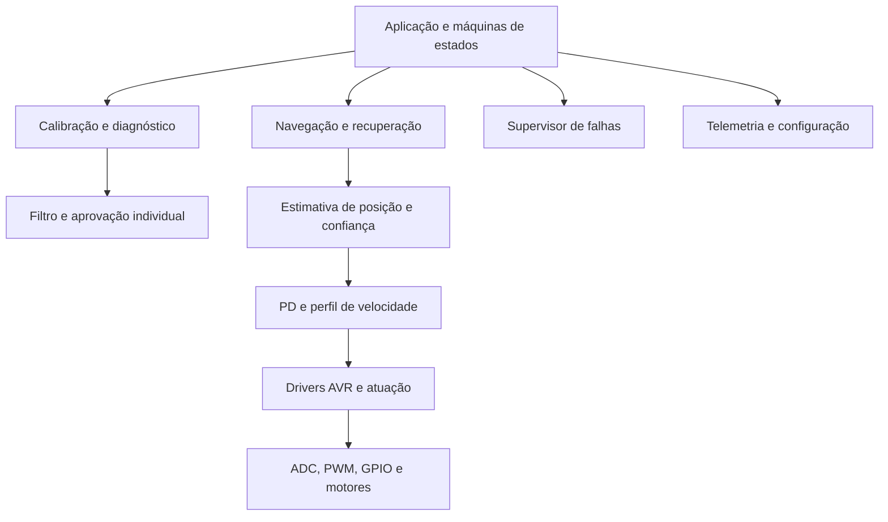

# Arquitetura do firmware

[Início](../README.md) · [Estados](firmware-state-machine.md) · [Calibração](calibration.md)

A arquitetura do Pegasus acompanha o caminho que a informação percorre no robô. Primeiro, o ADC do ATmega328P recebe os sinais da malha QTR. Esses valores passam pelo processamento dos sensores e, quando o controle de corrida estiver implementado, serão usados para calcular os comandos enviados ao TB6612FNG. A organização dos módulos procura manter cada parte responsável por uma etapa desse caminho, facilitando o desenvolvimento e a análise de problemas.

## Organização atual

| Local | Responsabilidade e situação |
| --- | --- |
| `src/main.c` | GPIO, estados, movimento de calibração, estrutura SENSOR e filtro |
| `lib/adc` | Conversão não bloqueante consultada pelo laço principal |
| `lib/pwm` | Timer0 e atualização de duty cycle |
| `lib/timer` | Timer1, eventos e contador de segundos |
| `lib/sensor` | Normalização individual 0–1000, disponível sem integração no main |
| `lib/usart` | Transmissão 115200 8N1 bloqueante, disponível sem integração no main |
| `lib/flash` | Arquivos reservados; persistência ainda sem implementação |
| `tests/host` | Simulação parcial de registradores e testes de diagnóstico |

## Separação prevista

`app.c`, `calibration.c` e `navigation.c` são módulos previstos para retirar decisões de aplicação do arquivo principal. `sensor_filter.c`, `calibration_check.c`, `line_estimator.c`, `controller.c`, `speed_profile.c` e `fault_manager.c` concentram algoritmos testáveis em computador. GPIO, EEPROM e watchdog terão drivers próprios quando forem implementados.

Nessa organização prevista, o filtro recebe a amostra e o histórico do canal para decidir como atualizar a leitura. A aplicação utiliza o resultado para conduzir a calibração e definir quando o movimento deve continuar ou parar. Os drivers ficam responsáveis pelo acesso aos periféricos. Para conectar essas etapas, a aquisição deverá informar o canal, o valor e a idade da leitura, permitindo que o estimador produza uma posição acompanhada de confiança antes de qualquer atualização dos motores.

## Aquisição e interfaces existentes

`adc_init()` seleciona AVcc, alinhamento à esquerda e prescaler 128. `adc_read(canal, &valor)` inicia a conversão e retorna zero; chamadas seguintes retornam zero enquanto ADSC estiver ativo. Ao concluir, ADCH fornece oito bits e a função retorna um se o canal solicitado coincidir com o canal convertido. Mantenha o mesmo canal até o sucesso: trocar durante a conversão descarta o resultado. Retorno zero também cobre argumento inválido, portanto ainda não distingue espera de erro.

`pwm_init()` configura Fast PWM de oito bits em OC0A/PD6 e OC0B/PD5, sem prescaler: frequência nominal de 62,5 kHz. `pwm_set_duty()` converte porcentagem em 0–255 com arredondamento. O chamador precisa limitar 0–100 e validar canal; a rotina atual não satura entradas e encaminha valores diferentes de PWM_A para PWM_B. Direção é controlada no main.

Timer1 usa CTC, prescaler 64 e OCR1A=249, produzindo comparação nominal a cada 1 ms enquanto ativo. A ISR acumula eventos de 1, 10, 100 e 1000 ms e incrementa segundos. `timer1_take_events()` lê e limpa flags atomicamente: eventos repetidos se fundem, portanto esse bitmap não conta ciclos perdidos. `timer1_start()` retoma a contagem; não reinicia a época. O contador de segundos é de 16 bits e exige tratamento explícito de retorno a zero em usos prolongados.

## Estimador e controlador projetados

Após validar a calibração, cada canal fornece `n = clamp(1000 × (adc − min)/(max − min), 0, 1000)`. A implementação em `sensor_lib` trata os limites antes da subtração e usa produto de 32 bits. Retornar zero para intervalo inválido não substitui uma flag de validade. A polaridade medida define a resposta `q` à presença da linha; a escala maior não aumenta a resolução física.

A posição é `p = Σ(wᵢqᵢ)/Σ(qᵢ)`, com pesos iniciais −2500, −1500, −500, 500, 1500 e 2500, sujeitos à ordem física. O numerador requer inteiro assinado de 32 bits. Soma zero invalida a posição. Confiança considera soma, sensores ativos, largura, saturação e coerência temporal; soma elevada também pode indicar cruzamento.

O PD usa `e = p_ref − p`, `u = Kp·e + Kd·(e − e_anterior)/Ts` e comandos `PWM_L = sat(v_base − u)`, `PWM_R = sat(v_base + u)`. Os sinais precisam de confirmação física. Derivada filtrada, limites individuais e rampa de duty reduzem ruído e mudanças abruptas. Integral só entra com justificativa experimental e anti-windup. Em retas confiáveis o perfil aumenta a base; erro, curvatura e incerteza a reduzem. Sem encoders, o fechamento de malha ocorre sobre a linha, não sobre velocidade medida das rodas.
