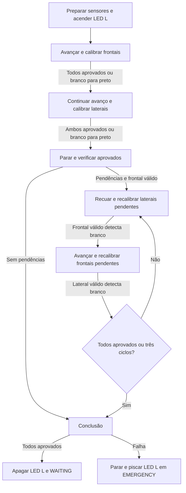

# Calibração automática dos sensores

[Início](../README.md) · [Compilação e testes](development.md)

A implementação fica em `src/calibration/`, separada em coordenação (`calibration.c`), aquisição inicial (`calibration_initial.c`), diagnóstico (`calibration_diagnostic.c`), filtro (`calibration_filter.c`) e detecção (`calibration_detection.c`). Os dados e subestados são compartilhados somente entre esses módulos pelo header privado `calibration_internal.h`. A máquina de estados em `src/main.c` chama `calibration_sensor(&state)` em `CALIBRATION` e continua chamando em `EMERGENCY` para atualizar o LED de defeito.

## Sequência implementada

O `main.c` reconhece um toque curto no botão ativo alto: pressionar e soltar antes de dois segundos, com debounce de 30 ms. Segurar por dois segundos leva a `WAITING`, sem iniciar a calibração. Com acionamento, a calibração reinicia os oito sensores com mínimo 255, máximo zero e filtro zerado, liga emissores e LED L e solicita 20% de PWM nos dois motores.

1. **Frontal:** avança em linha reta e executa o filtro para QTR01–QTR06 ainda não aprovados. Passa aos laterais quando todos os frontais estão aprovados ou quando um frontal confirma a passagem de branco para preto. Os aprovados continuam disponíveis para leitura, preservando os extremos.
2. **Lateral:** continua o mesmo avanço, sem parar ou inverter na troca de grupo. Executa o filtro para QTR00 e QTR07 ainda não aprovados. Para e entra no diagnóstico quando ambos estão aprovados ou quando um lateral confirma branco seguido de preto.
3. **Diagnóstico:** conserva os aprovados em RAM e reinicia somente os canais reprovados. Sem pendências, passa direto à conclusão.
4. **Recalibração lateral:** começa de ré e atualiza somente os laterais pendentes. Para quando qualquer frontal aprovado confirma branco. Precisa de pelo menos um frontal válido para iniciar esse movimento.
5. **Recalibração frontal:** depois da pausa de inversão, avança atualizando somente os frontais pendentes. Para quando qualquer lateral aprovado confirma branco. A aprovação dos laterais é reavaliada ao terminar o recuo, permitindo usar um lateral recém-recuperado como referência.
6. **Conclusão:** reavalia os frontais ao terminar o avanço. Se todos passaram, conclui. Caso ainda haja pendências, repete ré e avanço até o limite de três ciclos completos. Canais aprovados ao final do respectivo trecho saem da máscara de recalibração.

## Detecção de linha e limites

Na calibração inicial ainda não existem extremos válidos para todos os sensores. A passagem de branco para preto usa `CAL_LINE_THRESHOLD=128` no ADC de oito bits, ajustável em `include/pegasus_config.h`. Com `CAL_WHITE_HIGH=0`, branco significa ADC abaixo do limiar; com 1, significa acima. Cada canal precisa confirmar dez amostras consecutivas de branco antes de vinte consecutivas de preto. As duas janelas de preto dão ao filtro a oportunidade de confirmar o novo extremo. A troca de grupo ocorre ao terminar a varredura corrente, sem misturar amostras de canais.

No diagnóstico, a identificação de branco usa o ponto médio do mínimo e máximo da referência aprovada e exige dez amostras consecutivas no mesmo canal. Leituras isoladas de branco não provocam inversão. A referência vem sempre do grupo oposto ao que está sendo recalibrado.

Cada trecho possui timeout nominal definido por `CAL_TIMEOUT_SECONDS` (atualmente três segundos), com resolução de segundos. Timeout ou ausência de referência válida provoca PWM zero e falha, sem movimento indefinido. Antes das inversões no diagnóstico, o PWM permanece zero por `MOTOR_REVERSE_DELAY_SECONDS=2` segundos nominais. O primeiro diagnóstico é de ré; a calibração inicial inteira é para frente.

## LED e dados em RAM

O LED L permanece aceso durante a calibração. Só apaga quando todos os sensores estiverem aprovados; a calibração para o Timer1 e o estado global passa para `WAITING`. A aplicação retoma o timer para acompanhar o botão. Em falha, os motores param, os emissores desligam e o LED alterna a cada segundo. O Timer1 continua ativo para produzir essa indicação em `EMERGENCY`.

Os limites ficam somente na RAM e são perdidos ao desligar ou reiniciar. Não há leitura nem escrita em EEPROM. Em WAITING ou EMERGENCY, solte o botão e faça um novo toque curto para iniciar uma nova calibração. Não há início automático de corrida.

## Filtro por canal

Dez amostras formam uma média inteira. A primeira média apenas inicializa o candidato. Nas seguintes, calcula-se a diferença absoluta para o candidato anterior:

| Condição | Ação |
| --- | --- |
| Sem transição pendente e diferença <50 | Aceitar o candidato anterior nos extremos |
| Sem transição pendente e diferença ≥50 | Marcar transição pendente |
| Com transição pendente e diferença <10 | Aceitar o candidato anterior e limpar pendência |
| Com transição pendente e diferença ≥10 | Manter pendência |

Ao final, o candidato é substituído pela média nova, mesmo quando a transição continua pendente. Assim, a confirmação compara janelas consecutivas, e não uma referência fixa. Igualdade a 50 inicia transição; igualdade a 10 não confirma. Deriva lenta pode deslocar os extremos. O filtro precisa de ensaios para caracterizar rejeição de pulsos e latência; não deve ser reutilizado automaticamente no controle periódico de corrida.

## Validação

`sh tests/host/run.sh` executa os cenários com ADC assíncrono simulado: avanço inicial contínuo, passagem branco/preto sem contraste suficiente, ordem ré/avanço, recuperação em um ou três ciclos, preservação dos aprovados, ruído, ausência de referência, timeout, ADC sem progresso, polaridade invertida e LED de sucesso/falha.
