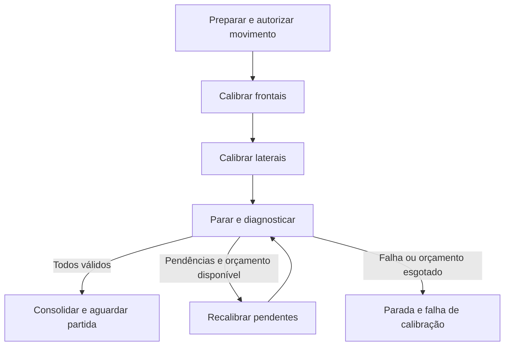

# Calibração automática dos sensores

[Início](../README.md) · [Arquitetura](architecture.md) · [Validação](testing-and-validation.md)

A calibração estabelece os valores mínimo e máximo que representam a resposta de cada sensor da malha QTR. Como os frontais e os laterais passam por regiões diferentes durante o movimento, o procedimento precisa respeitar essa geometria e trabalhar com cada grupo em sua própria etapa. O filtro e a etapa frontal já estão em `src/main.c`; a sequência lateral e o diagnóstico serão acrescentados a partir dessa base.

Para acompanhar a execução chamada por chamada, consulte [Funcionamento do sistema: calibração](system-operation.md), que inclui o fluxograma dos estados atuais. Aqui ficam reunidos os parâmetros, critérios de aprovação e decisões para a evolução da rotina.

## Sequência implementada

Ao entrar em INIT_CALIBRATION, Timer1 inicia e o programa espera o botão em nível alto. Após dois segundos sem acionamento, entra em WAITING, que ainda não processa novos eventos. Essa espera é bloqueante. Com o botão acionado, todos os sensores são reiniciados com min=255, max=0 e acumuladores zerados. MOTORS_KEY=1 habilita comandos de 20% nos dois motores; os emissores são ligados e o LED é apagado.

FRONT_CALIBRATION percorre QTR01–QTR06 e avança apenas quando `adc_read()` entrega a amostra. Cada sensor possui acumulador e contador próprios. Ao atingir contraste de pelo menos 40 entre extremos aceitos, recebe `aproved=1` e deixa de ser amostrado nessa etapa. Quando os seis estão aprovados, os dois PWMs são zerados, Timer1 para e a rotina entra em LATERAL_CALIBRATION, cujo corpo está vazio. Os emissores permanecem ligados. Não existe ainda transição para corrida nem relatório serial nesse caminho.

O limite frontal é de cinco segundos, baseado em contador com resolução de segundos. Ao expirar, o código zera os PWMs, desliga emissores, acende o LED, para Timer1 e entra em EMERGENCY com CALIBRATION_FAULT. O desligamento ocorre nesse ramo; o corpo de EMERGENCY ainda não é um supervisor completo.

## Filtro por canal

Dez amostras formam uma média inteira. A primeira média apenas inicializa o candidato. Nas seguintes, calcula-se a diferença absoluta para o candidato anterior:

| Condição | Ação |
| --- | --- |
| Sem transição pendente e diferença <50 | Aceitar o candidato anterior nos extremos |
| Sem transição pendente e diferença ≥50 | Marcar transição pendente |
| Com transição pendente e diferença <10 | Aceitar o candidato anterior e limpar pendência |
| Com transição pendente e diferença ≥10 | Manter pendência |

Ao final, o candidato é substituído pela média nova, mesmo quando a transição continua pendente. Assim, a confirmação compara janelas consecutivas, e não uma referência fixa. Igualdade a 50 inicia transição; igualdade a 10 não confirma. Deriva lenta pode deslocar os extremos. O filtro precisa de ensaios para caracterizar rejeição de pulsos e latência; não deve ser reutilizado automaticamente no controle periódico de corrida.

## Procedimento completo previsto

Na etapa lateral prevista, QTR00 e QTR07 deverão passar por `sensor_calibration_update()`, aproveitando o mesmo filtro individual. Depois, o diagnóstico deverá combinar o contraste observado com o ruído medido e a qualidade do sinal, usando também a mediana como referência para comparar canais. A mediana sozinha não aprova um conjunto em que todos os contrastes são quase nulos. Frontais e laterais terão critérios próprios, definidos por medições.

A política proposta congela extremos e flags dos sensores aprovados durante repetições; reinicia apenas pendentes. Define-se uma tentativa adicional como uma varredura completa entre referências confiáveis, registrando essa convenção nos logs. O limite inicial é três tentativas adicionais, configurável após ensaios. Cada deslocamento tem timeout próprio, além do orçamento total.

Toda inversão passa por PWM zero, intervalo de desaceleração medido, troca de direção e rampa. Referências inválidas não podem ser o único limite do deslocamento. A distância entre sensores deve ser medida: tempo sozinho não garante posição. Esgotar limites leva a CALIBRATION_FAULT e impede RUNNING.

A persistência prevista usa EEPROM, com magic, tamanho, versão, parâmetros, CRC e marca de validade. Gravar somente após aprovação completa, com política para escrita interrompida e desgaste. Não existe persistência funcional em `lib/flash`; Flash de programa não é o armazenamento padrão proposto.
