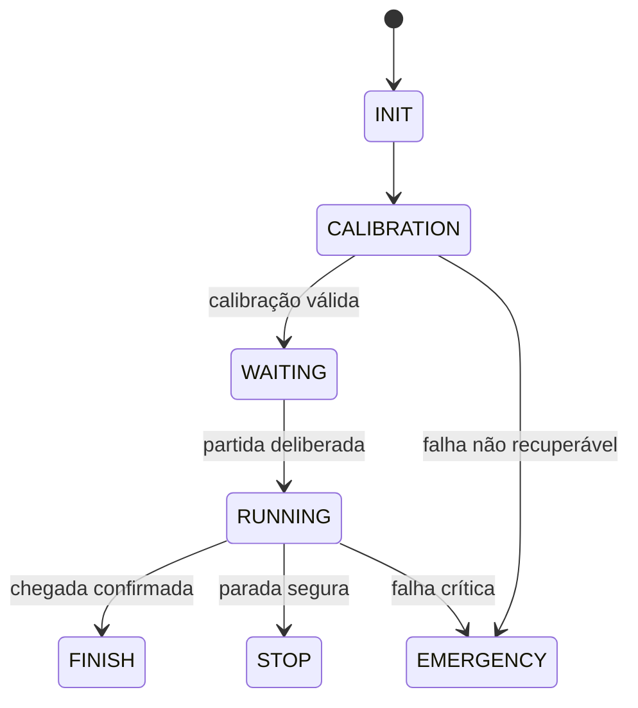

# Estados, navegação e tratamento de falhas

[Início](../README.md) · [Calibração](calibration.md)

A máquina de estados organiza o que o robô pode fazer em cada momento. No ATmega328P, o laço principal consulta o estado global e chama a rotina correspondente. Durante a calibração, essa rotina possui seus próprios subestados para acompanhar a preparação e a leitura da malha QTR. O [fluxograma da calibração atual](system-operation.md) mostra esse caminho conforme o main está implementado; o ciclo abaixo apresenta a evolução prevista para a aplicação completa.

## Ciclo de operação projetado

| Estado | Responsabilidade de referência | Implementação atual |
| --- | --- | --- |
| INIT | Saídas seguras, periféricos, causa de reset e configuração | Inicialização periférica no main e passagem à calibração |
| CALIBRATION | Frontais, laterais, diagnóstico e repetição | Etapa frontal e timeout |
| WAITING | Motores parados; botão e parâmetros validados | Corpo vazio |
| RUNNING | Aquisição, estimativa, controle e supervisão | Corpo vazio |
| FINISH | Parada e resumo da corrida | Corpo vazio |
| STOP | Manter parada e motivo | Corpo vazio |
| EMERGENCY | Atuação segura e liberação deliberada | Corpo vazio; timeout frontal desliga antes de entrar |

O diagrama representa o contrato de evolução. No código atual, WAITING é alcançado por timeout do botão; concluir a etapa frontal permanece em CALIBRATION/LATERAL_CALIBRATION. Não há corrida funcional. A detecção de chegada, o comportamento do botão e o reinício precisam de critérios definidos antes da integração.

## Navegação dentro de RUNNING

TRACKING opera com posição válida. LINE_SUSPECT reduz velocidade ao detectar confiança baixa. LINE_LOST confirma ausência ou ambiguidade persistente. RECOVERY busca a linha usando último lado conhecido, histórico de erro e laterais válidos, com limites de PWM e tempo. SAFE_STOP encerra a atuação quando falta referência ou o orçamento acaba; é um subestado previsto e pode solicitar STOP global. Histerese evita alternância excessiva; cruzamento e faixa larga exigem classificação própria.

Falhas e pedidos de parada têm prioridade sobre sucesso e telemetria. Toda entrada em parada deve aplicar saídas seguras, preservar causa e impedir reativação por comando atrasado. O estado deve ser revalidado ao executar uma solicitação enfileirada. EMERGENCY exige reset ou ação deliberada conforme política a implementar.

## Matriz de falhas prevista

| Condição | Evidência disponível | Resposta de referência e limite |
| --- | --- | --- |
| Linha ausente | Padrão e confiança frontal | Reduzir, buscar com limite, parar; pode ser curva fechada |
| ADC saturado | Persistência em 0 ou 255 | Suspeitar e reduzir confiança; superfície extrema também satura |
| Sensor constante | Baixa variância e incoerência durante movimento | Confirmar antes de isolar; pista homogênea também é constante |
| Calibração parcial | Contraste e diagnóstico | Repetir pendentes até o limite; bloquear corrida |
| Nenhum sensor confiável | Flags e validade | SAFE_STOP |
| Atraso ou travamento | Prazo excedido e WDT | Parada/reset; verificar eletricamente o reinício |
| Comunicação perdida | Erros e timeout | Descartar logs; autonomia local depende de condições seguras |
| EEPROM inválida | Versão, limites e CRC | Rejeitar registro e recalibrar |
| Alimentação instável | Causa de reset e BOD | Saídas seguras no boot; sem circuito VBAT não há tensão medida |
| Motor travado ou invertido | Auditoria e incoerência indireta | Parar; sem encoder/corrente a identificação é limitada |
| Inversão abrupta | Sequência de comandos | PWM zero, desaceleração, inversão e rampa |
| Botão inválido | Debounce e tempo de evento | Não armar e aplicar timeout |

Oito sensores não garantem redundância funcional: geometria e falha comum importam. WDT deve ser ativado após inicialização e alimentado somente com progresso real. Registrar MCUSR antes de limpá-lo; revisar fusíveis BOD conforme alimentação efetiva. Essas funções ainda não foram integradas. A segurança elétrica no reset e o estado STBY exigem validação própria; uma chave de corte da alimentação dos motores pode fornecer interrupção independente do MCU.
