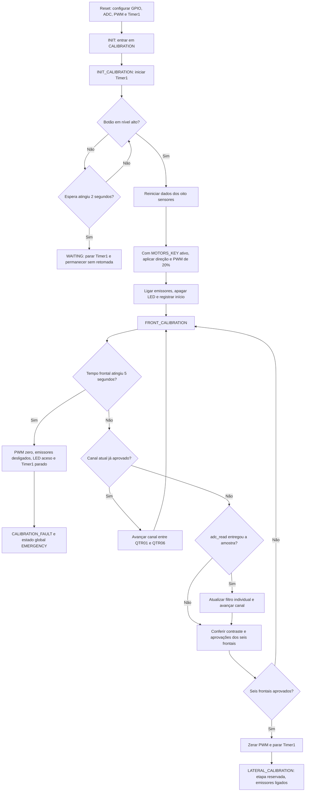

# Funcionamento do sistema: calibração

[Início](../README.md) · [Critérios de calibração](calibration.md) · [Hardware](hardware.md)

A calibração é a primeira parte funcional do Pegasus. Ela permite que o firmware encontre uma faixa de leitura para cada sensor da malha, levando em conta o sinal que realmente chega ao ADC do ATmega328P. Esses valores serão usados posteriormente para comparar sensores e estimar a posição da linha, mesmo quando os canais apresentarem respostas diferentes entre si.

A explicação abaixo acompanha `src/main.c` na versão atual. O movimento é comandado pelo TB6612FNG e a aquisição frontal utiliza QTR01 a QTR06. QTR00 e QTR07 estão presentes na estrutura de dados, mas ainda não participam de uma rotina lateral implementada.

## Da inicialização ao início da leitura

Ao ligar ou reiniciar o robô, `main()` configura as entradas e saídas, acende o LED e mantém o comando dos emissores desligado. Depois inicializa ADC, PWM e Timer1, habilita as interrupções e solicita duty zero nos dois canais. O laço principal começa em INIT e passa para CALIBRATION, onde chama `calibration_sensor()` repetidamente.

Essa função guarda seu próprio estado em uma variável estática. Isso permite continuar de onde parou a cada chamada, mantendo também os dados dos oito sensores. O primeiro subestado é INIT_CALIBRATION: ele inicia Timer1 e aguarda o botão em nível alto. Se o contador indicar dois segundos sem acionamento, a aplicação passa para WAITING e para o timer. Como WAITING ainda está vazio, apertar o botão depois desse ponto não retoma a calibração na implementação atual.

Quando o botão é reconhecido, o firmware prepara todos os sensores com mínimo 255 e máximo zero, limpa as médias e remove as aprovações anteriores. Essa combinação inicial sinaliza que ainda não existe um intervalo aceito. Com MOTORS_KEY habilitado, aplica a direção configurada no código e PWM de 20% aos dois canais. Em seguida, liga os emissores em PB3, apaga o LED e registra a referência de tempo usada na etapa frontal.

## Máquina de estados implementada

O fluxograma mostra os caminhos existentes hoje. As caixas de espera e calibração lateral são pontos em que o código permanece, pois suas próximas transições ainda não foram implementadas.

O timeout frontal é conferido antes da leitura e da aprovação. Portanto, se o prazo já tiver sido atingido naquela chamada, a saída será por falha. O contador utilizado tem resolução de segundos, e o timer já estava ativo durante a espera pelo botão, então esse limite não representa uma medição precisa de cinco segundos a partir do primeiro comando de movimento.

## Como cada sensor é processado

A aquisição começa em QTR01 e percorre os seis frontais. `adc_read()` inicia uma conversão e devolve zero enquanto o resultado ainda não está disponível. O firmware mantém o canal solicitado até receber uma amostra válida; só então a entrega ao filtro e avança. O ADC usa alinhamento à esquerda e leitura de ADCH, fornecendo valores de 0 a 255.

Cada estrutura SENSOR guarda seu próprio acumulador, contador, média candidata, extremos e flags. Assim, uma amostra de QTR02 não altera a média de QTR01. Quando um canal completa dez amostras, `sensor_calibration_update()` calcula a média inteira e zera o acumulador para a próxima janela. As dez amostras pertencem ao mesmo canal, mas são obtidas ao longo de várias passagens pela malha.

A primeira média apenas estabelece o candidato. A partir da segunda, o filtro compara a média nova com a anterior. Se a diferença for menor que 50 e não houver transição pendente, o candidato anterior pode atualizar os extremos. Se a diferença chegar a 50 ou mais, o filtro marca uma possível mudança de patamar e aguarda confirmação.

Durante essa pendência, uma diferença menor que 10 entre médias consecutivas permite aceitar o candidato e encerrar a transição. Se a diferença continuar maior ou igual a 10, a pendência permanece. Ao final de cada janela, o candidato recebe a média mais recente, inclusive enquanto aguarda confirmação. O valor comparado, portanto, acompanha a sequência de leituras.

Por exemplo, considere quatro janelas cujas médias sejam 220, 218, 35 e 33. A primeira estabelece a referência. A segunda aceita 220, porque a diferença foi de apenas dois pontos. A terceira marca a transição para uma região muito diferente. A quarta confirma a estabilidade perto de 35 e aceita esse valor. Nesse exemplo, os extremos passam a ser 35 e 220, produzindo contraste de 185. Trata-se de uma leitura manual da lógica, não de um resultado medido na pista.

## Aprovação e encerramento

Depois de processar a aquisição, a rotina confere os seis sensores. Quando um canal possui `min <= max`, calcula `contrast = max - min`. Se o contraste atingir 40, marca `aproved=1`, preservando a grafia usada no código. Nas próximas visitas, esse sensor será pulado, de forma que seus extremos ficam congelados enquanto os demais continuam sendo calibrados.

Quando todos passam pelo critério, os dois PWMs recebem zero e Timer1 é parado. A aplicação continua em CALIBRATION, agora no subestado LATERAL_CALIBRATION. Os emissores permanecem ligados e ainda não existe relatório serial nesse caminho. O subestado DIAGNOSTIC também está declarado, mas não é executado nessa sequência.

Se o limite de tempo for atingido antes da aprovação completa, o firmware aplica PWM zero, desliga os emissores, acende o LED e para Timer1. Ele registra CALIBRATION_FAULT internamente e muda o estado global para EMERGENCY. As ações de desligamento estão nesse ramo de timeout; o corpo de EMERGENCY ainda não acrescenta supervisão nem permite recuperação automática.

## O que vem depois

A próxima implementação deve aproveitar o mesmo processamento individual para QTR00 e QTR07, acrescentando o movimento adequado à posição dos laterais. Depois disso, o diagnóstico poderá avaliar a qualidade do conjunto e decidir quais canais precisam de nova tentativa. Os critérios planejados, a política de repetição e a persistência estão descritos em [Calibração automática dos sensores](calibration.md).
