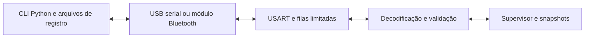

# Comunicação, diagnóstico e configuração

[Início](../README.md) · [Desempenho](performance.md)

A comunicação foi planejada para acompanhar o que acontece dentro do robô enquanto cada etapa é desenvolvida. Pela USART0 do ATmega328P, o computador poderá receber as leituras da malha QTR, os resultados da calibração e os comandos enviados aos motores. Essas informações ajudam a relacionar o comportamento observado na pista com as decisões do firmware. A interface Python Pegasus CLI e o transporte com filas descritos neste documento ainda fazem parte do planejamento.

## Driver disponível

`lib/usart` configura USART0 para 115200 baud nominal, 8 bits, sem paridade e um bit de parada. Usa U2X0=1 e UBRR=16 a 16 MHz, resultando em aproximadamente 117647 baud, erro de +2,12%. Somente transmissão é habilitada. Cada caractere espera UDRE0 em laço bloqueante; não há RX, fila nem interrupção de transmissão. O main atual não inicializa nem chama essa biblioteca, portanto não emite relatório ao finalizar a calibração frontal.

## Transporte projetado

A evolução prevê buffer circular de 64–128 bytes como ponto inicial, condicionado à SRAM, e transmissão por interrupção UDRE. Validar capacidade antes de escrever; telemetria cheia deve ser descartada ou reduzida com contador explícito. Recepção verifica erros, comprimento, versão, integridade e timeout. Parsing e formatação recebem orçamento limitado no laço principal. Evitar floats formatados no caminho crítico.

## Dados e permissões

O relatório de calibração previsto contém canal, MIN, MAX, RAW, NORM, CONTRAST e STATUS. MIN/MAX descrevem extremos aceitos pelo filtro, não necessariamente extremos brutos. NORM é calculado somente com intervalo válido; aprovação frontal não representa aprovação dos oito sensores. Emitir uma vez após a etapa definida, com resultado parcial claramente identificado.

Na corrida, quadros curtos incluem timestamp, sequência, estado, erro, confiança, PWM comandado e código de falha. Agregados incluem duração máxima do ciclo, variação de período, resets, falhas, tempo de calibração e perdas de linha. PWM não significa RPM. Registrar perdas de pacotes e intervalos ausentes no computador.

| Operação proposta | Permissão |
| --- | --- |
| Consultar estado e sensores | Snapshot existente com trabalho limitado |
| Consultar calibração | Leitura; nunca iniciar movimento implicitamente |
| Alterar ganhos e limites | Somente WAITING, após validação |
| Telemetria | Taxa limitada; parar streaming não significa parar motores |
| Solicitar parada | Supervisor prioriza atuação segura |
| Recalibrar ou reiniciar | Ação explícita e guardas satisfeitas |

Comandos candidatos: `status`, `sensors read`, `sensors calibration`, `motors status`, `control parameters`, `telemetry start`, `telemetry stop`, `race stats` e `system info`. A sintaxe é proposta e ainda não executável. Um protocolo binário deverá definir versão, sequência, comprimento, checksum/CRC e ressincronização. Distinguir aceitação de conclusão, e evitar repetir movimentos ao retransmitir pedidos.
